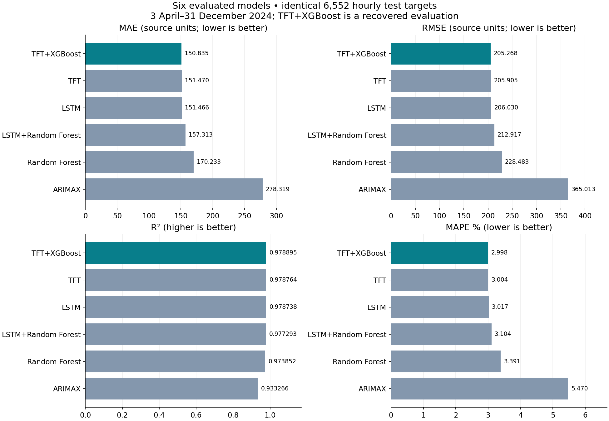
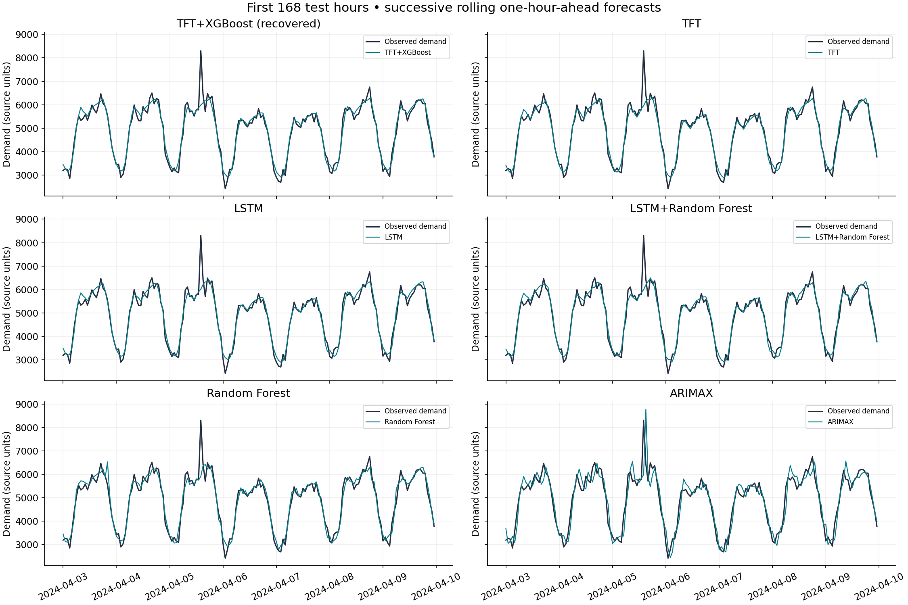

# Electricity-Demand-Forecasting

## Project overview

An internship project comparing six statistical, tree, neural and residual-hybrid approaches to hourly electricity-demand forecasting. This repository combines the recovered original shared implementation and six corrected notebook entry points with audited final results. The notebooks have no saved execution outputs; the verified scores come from saved result CSVs and manifests.

## Problem statement

Predict demand one hour ahead using information available before the target hour. Accurate short-term forecasts can support scheduling and capacity planning. This study evaluates historical predictive accuracy; it does not demonstrate a deployed operational forecasting service.

## Dataset and Preprocessing

The project uses an hourly electricity demand dataset containing **43,848 records from 2020 to 2024**, including electricity demand, temperature, humidity, and time-related information.

The following preprocessing steps were performed:
- Converted date and hour information into proper timestamps.
- Checked for duplicate timestamps and inconsistencies.
- Handled missing values using available historical information.
- Created time-based features such as hour, day, and month.
- Generated historical demand features, including lag values and rolling statistics.
- Prevented data leakage by ensuring that models only use information available before the prediction time.

All six models were evaluated using the same dataset and test period to ensure a fair comparison.

Dataset Availability: The original dataset is not included in this repository. A sample input schema is provided in the data/ folder.

## Models implemented

| Model | Implementation |
|---|---|
| TFT+XGBoost | Upgraded TFT with XGBoost residual correction; recovered final evaluation |
| TFT | Temporal Fusion Transformer |
| LSTM | Two-layer recurrent demand model |
| LSTM+Random Forest | LSTM plus separately calibrated residual forest |
| Random Forest | Lag/calendar/weather feature regression |
| ARIMAX | ARIMA(2,0,2) with exogenous regressors and rolling state updates |

The historical notebook filename `SARIMA_alone.ipynb` is retained for traceability; its implementation is nonseasonal ARIMAX. Detailed model settings are in the actual [shared source](forecasting/) and saved [manifests](reports/evidence/).

## Experimental methodology

The dataset was divided chronologically to prevent data leakage, with the first 168 hours used as historical context.

The remaining data was split as follows:

| Purpose | Percentage |
|---|---:|
| Model Training | 70% |
| Validation (Early Stopping) | 7.5% |
| Hybrid Model Calibration | 7.5% |
| Testing | 15% |

For XGBoost, the final 20% of its calibration data was reserved for early stopping. A random seed of 42 was used.

All six models were evaluated on the same **6,552 hourly test observations (3 April – 31 December 2024)** using rolling one-hour-ahead forecasting.

Five models completed standard experiment runs. The TFT+XGBoost result was obtained through a recovered evaluation using an existing TFT checkpoint and a refitted XGBoost model. None of the reported results came from smoke tests.

## Metrics and results

MAE is mean absolute error; RMSE is the square root of mean squared error. Both use demand source units and lower is better. R² measures explained variation (higher is better). MAPE is mean absolute percentage error (lower is better); zero targets are excluded. No missing or zero targets were excluded from these test scores. [comparison.csv](reports/comparison.csv) preserves full precision, including MSE.

| Model | MAE | RMSE | R² | MAPE % |
|---|---:|---:|---:|---:|
| TFT+XGBoost | 150.835 | 205.268 | 0.978895 | 2.998 |
| TFT | 151.470 | 205.905 | 0.978764 | 3.004 |
| LSTM | 151.466 | 206.030 | 0.978738 | 3.017 |
| LSTM+Random Forest | 157.313 | 212.917 | 0.977293 | 3.104 |
| Random Forest | 170.233 | 228.483 | 0.973852 | 3.391 |
| ARIMAX | 278.319 | 365.013 | 0.933266 | 5.470 |

## Graphs





The combined plots were rebuilt solely from verified metrics and saved predictions. See all [six original forecast plots](reports/FIGURES.md).

## Key findings

TFT+XGBoost has the lowest saved RMSE (205.268), 0.31% below standalone TFT. This single-seed difference does not establish statistical superiority. The upgraded TFT base differs from standalone TFT: its own RMSE was 207.765, reduced 1.20% by XGBoost. LSTM+Random Forest increased its own base RMSE from 206.030 to 212.917, a 3.34% deterioration. LSTM has marginally lower MAE than standalone TFT.

The optional weekly seasonal-naive reference has RMSE 330.171, MAE 243.479, R² 0.945398 and MAPE 4.809%. It is a reference benchmark, separate from the six trained models; ARIMAX performs worse than that reference.

The TFT+XGBoost export is a recovered evaluation using an existing epoch=30 checkpoint (zero-based) and refitted XGBoost. No new TFT training occurred during recovery. The configured maximum of 100 epochs does not establish 100 completed epochs, and the 59.371-second duration is recovery time only.

## Installation and execution

Use Python 3.12 and run from the repository root. The original requirements are preserved; the saved final manifests record Python 3.13.15/3.13.16 environments. A clean installation of all pins has not been repeated for publication.

```text
python -m venv .venv
```

Activate with `.venv\Scripts\activate` on Windows or `source .venv/bin/activate` on macOS/Linux, then:

```text
python -m pip install -r requirements.txt
python -m forecasting --model random_forest --data data/electricity_demand.csv
python -m forecasting --model all --data data/electricity_demand.csv
python -m pytest tests -q
```

Supply the authorized dataset separately before running research experiments. A synthetic software check can run without it:

```text
python -m forecasting --model all --demo --smoke
```

Synthetic/smoke scores are software checks and must not replace the final results above. Neural models can take substantial compute and use early stopping. Fresh runs are not guaranteed to reproduce the recovered checkpoint result. For notebooks, install the environment as a Jupyter kernel and open any file in `notebooks/`; the first cell locates the repository root. In Colab, extract the full repository, change to its root, install requirements and restart the runtime if required. Set `FORECAST_DATA` to an authorized data path when needed.

## Repository contents

```text
README.md
requirements.txt
.gitignore
notebooks/                 six original entry points, adapted for this layout
forecasting/               recovered original shared implementation
tests/                     recovered original regression tests
reports/comparison.csv     six verified model rows
reports/results_summary.md
reports/figures/           two rebuilt comparisons and six original forecast PNGs
reports/evidence/          original metric CSVs and manifests
docs/                      corrections, validation and source provenance
data/example_schema.csv    headers only; no confidential observations
PUBLICATION_CHECKLIST.md
```

## Limitations

Single seed, no uncertainty estimates, and closely spaced leading scores limit ranking claims. Exact final-run source revision linkage, full epoch logs, the original hybrid checkpoint-selection history and the recovery script are unavailable. The shared source was recovered from the earlier corrected archive; its presence does not prove it is byte-identical to every final Colab run. Full raw prediction tables, private dataset and checkpoints are intentionally excluded. Dataset provenance, units, timezone and public redistribution permission remain unestablished. This checkout supports method inspection and software tests but cannot guarantee exact recovered inference reproduction. See [validation](docs/VALIDATION.md) and the [publication checklist](PUBLICATION_CHECKLIST.md).

## Future work

Document dataset provenance and units; preserve exact code revisions, environments, training logs and checkpoint-selection records; evaluate multiple seeds and uncertainty; examine errors by month/hour and peak events; test additional horizons and a separately specified seasonal statistical model; validate deployment with real prediction-time covariates.
