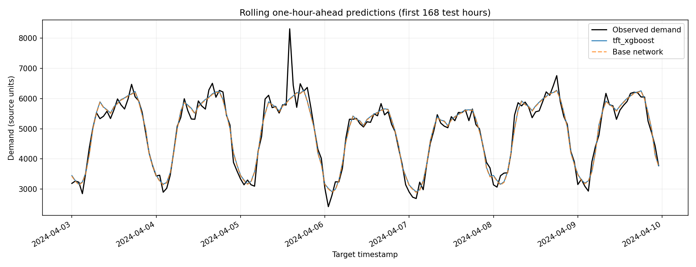
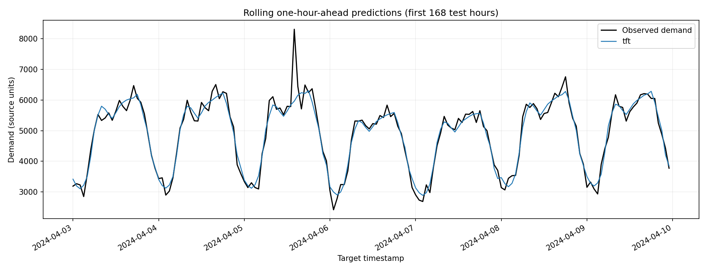
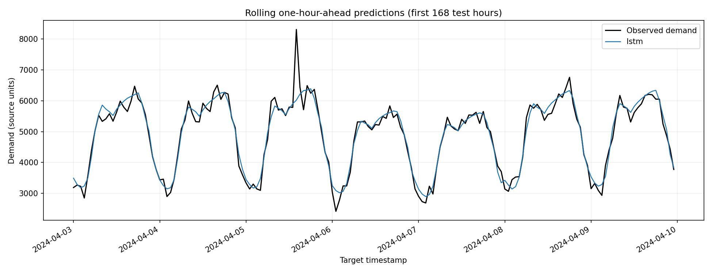
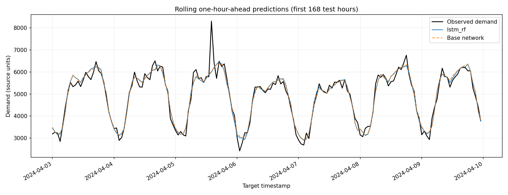
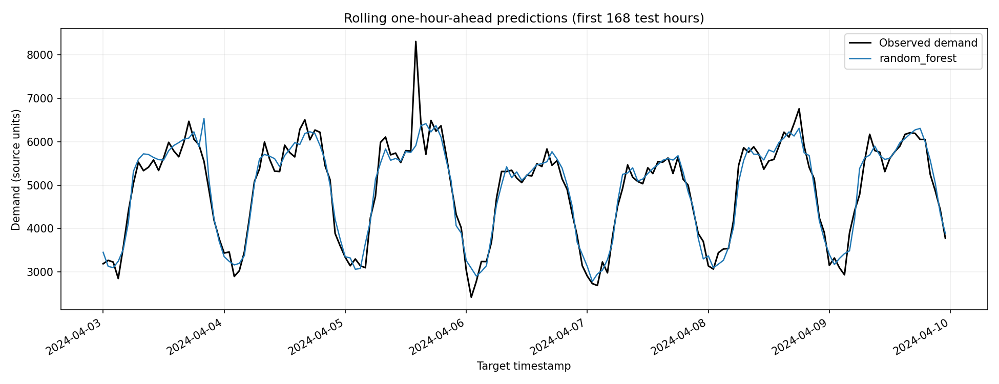
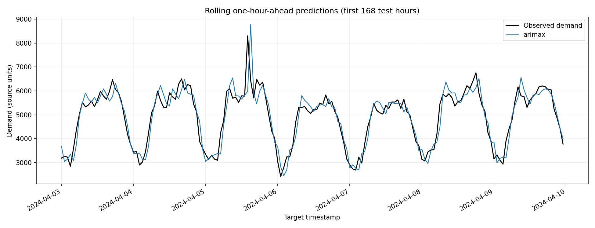

# Original saved forecast plots

These are the six unmodified source PNGs. They show the first 168 successive one-hour-ahead predictions in source units. Hybrid plots also show their own base network.

### TFT+XGBoost

### TFT

### LSTM

### LSTM+Random Forest

### Random Forest

### ARIMAX

